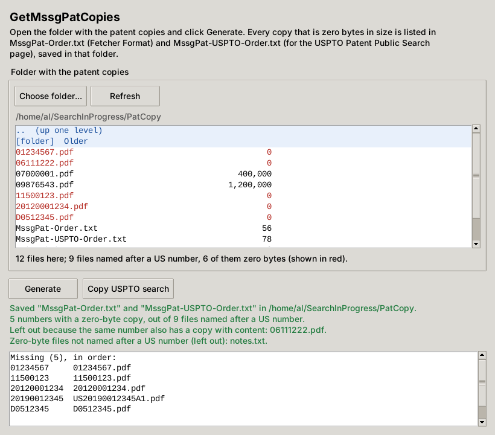

# GetMssgPatCopies

GetMssgPatCopies looks in a folder of patent copies for the ones that are **zero bytes** in size
(the copies that did not come through) and writes their numbers into two files in that same folder,
so they can be fetched again:

| File | Contents |
|---|---|
| `MssgPat-Order.txt` | Fetcher Format: one number per line, Windows line endings, in the standard form PatCopyPrint uses (`01234567`, `20120001234`, `D0512345`) |
| `MssgPat-USPTO-Order.txt` | One line to paste into the [USPTO Patent Public Search](https://ppubs.uspto.gov/pubwebapp/) box: `("1234567" or "20120001234" or "D512345").pn.` (a list too long for one search is split into several lines, one search each; see [The USPTO search](#the-uspto-search)) |

Both lists are in the same order, the sorted order of PatCopyPrint and RemoveDupNumbers: patents by
number, then published applications by number, then D, H, PP, RE and the other letter prefixes.

It is one Python program, `GetMssgPatCopies.py`, that runs anywhere PatCopyPrint runs (Windows 7,
Windows 11, Ubuntu 14.10 with Python 3.4, Fedora) and needs only Python's own library. It opens a
window when tkinter is available and otherwise works in the terminal. Nothing is sent anywhere.

## Starting it

- **Windows:** put `GetMssgPatCopies.py` and `GetMssgPatCopies.pyw` in the same folder and
  double-click **`GetMssgPatCopies.pyw`** (no black console window).
- **Linux:** `python3 GetMssgPatCopies.py`.
- `python3 GetMssgPatCopies.py --console` uses the terminal even when a window is possible, and
  `python3 GetMssgPatCopies.py FOLDER --yes` writes the two files for FOLDER without asking anything.

Installing Python (also offline) is described in the
[PatCopyPrint README](https://github.com/Al-bit-dot/PatCopyPrint#installing-python-on-a-computer-with-no-internet);
GetMssgPatCopies needs the same Python and nothing more.

The last folder is remembered in `.getmssgpatcopies.json` in your home folder.

## Using the window

1. Pick the folder as in PatCopyPrint: **Choose folder…** opens one, and the list shows its
   sub-folders (in blue) and its files with their sizes. Click a folder line or `..` to move
   around. The folder whose contents are shown is the one that will be read. Zero-byte patent
   copies are shown in red.
2. Click **Generate**. If the two files are already in the folder you are asked once before they
   are replaced. The result is shown below the button with the numbers found and the USPTO search.
3. **Copy USPTO search** puts the USPTO search on the clipboard. On the Patent Public Search page
   close the *Notification* pop-up, paste it into the search box and click **Search**. When the
   search has been split, the button reads **Copy USPTO search 1 of 3**; each click copies the
   next one.

## Using the terminal

The program lists the sub-folders of the remembered folder. Type a number to open a folder, a
path to go somewhere else, `g` (or just Enter) to generate the files for the folder shown, or `q`
to quit.

## Which files count

Only the files directly in the chosen folder are read (not its sub-folders). A file counts as a
patent copy when its name without the extension is a US number in any of these spellings:

| Kind | File names recognised | Fetcher list | USPTO line |
|---|---|---|---|
| Utility patent | `09123456.pdf`, `9123456.pdf`, `US9123456B2.pdf`, `US-9123456-B2.pdf` | `09123456` | `"9123456"` |
| Published application | `20120001234.pdf`, `2012001234.pdf`, `US20120001234A1.pdf` | `20120001234` | `"20120001234"` |
| Design, H, T, X | `D0512345.pdf`, `USD512345S.pdf` | `D0512345` | `"D512345"` |
| RE, RD, RX, AI, PP | `RE045678.pdf`, `USRE45678E.pdf`, `USPP12345P2.pdf` | `RE045678`, `PP012345` | `"RE45678"`, `"PP12345"` |

- A number is listed once, even when several zero-byte files have it (`9123456.pdf` and
  `09123456.pdf`).
- A number is **not** listed when another file of the same number in the folder has content
  (`06111222.pdf` is empty but `US6111222B1.pdf` is the real copy). The result names those files.
- Zero-byte files whose names are not US numbers (`notes.txt`, `WO2010123456.pdf`) are left out
  and named in the result.
- If no patent copy is zero bytes, nothing is written.

## The USPTO search

Everything below was tested on the live Patent Public Search site on 13 October 2026.

**Number spellings.** A `.pn.` search finds a document only when the number is spelled exactly the
way the site stores it, and that is what the program writes:

- patents below 10,000,000: seven digits with leading zeros (`"9123456"`, `"0012345"`, `"0000001"`);
- patents from 10,000,000 on: all eight digits (`"10123456"`, `"12700000"`);
- published applications: all 11 digits (`"20120001234"`); this finds A1, A2, A9 and P1 publications alike;
- letter prefixes: seven characters with the letters counting towards the seven (`"D512345"`,
  `"D000126"`, `"PP12345"`, `"RE45678"`, `"H001234"`, `"T876006"`, `"X000001"`, `"AI00100"`), and
  longer numbers in full (`"D1012345"`).

Any other spelling (`"09123456"`, `"12345"`, `"2012001234"`, `"2012/0001234"`, `"D0512345"`,
`"US9123456"`, `"9123456B2"`) finds nothing; it never finds a wrong document. A number the site
does not have (such as 12,345,678, or the many X numbers missing from it) is simply not found;
the other numbers in the search are still found. RD documents are not on the site at all.

The search ends in `.pn.` with the final period. Without it the site searches every field and
returns the patents that cite these numbers as well.

**Long lists.** The site refuses a search whose request is 8 KB or more: 131 published
applications, 155 patents of 8 digits or 166 older patents in one line. It then shows *Unable to
process your request, please try again later* (sometimes after an "N results found" count) and
lists nothing; trying again does not help. So the program keeps a little below that and puts at
most 120 published applications, 143 patents of 8 digits or 153 older patents (or D, RE, PP, H
numbers) in one line. When there are more it writes several lines, each a complete search in the
same format.
Paste and search **one line at a time**: lines pasted together run as one search, which is too
long.

**Reading the results.** The results are listed newest first, not in the order of the search.
Old patents (before 1976) are listed twice, from the USPAT and USOCR databases, so the "results
found" count can be higher than the number of documents. A published application and the patent
granted on it are one family: the second shows only as a **+1** button on the first one's row.

## Tests

`python3 test_getmssgpatcopies.py` checks the file-name rules, the sort order, the two file
formats, the splitting of long USPTO searches, a run over a sample folder and the command line.
